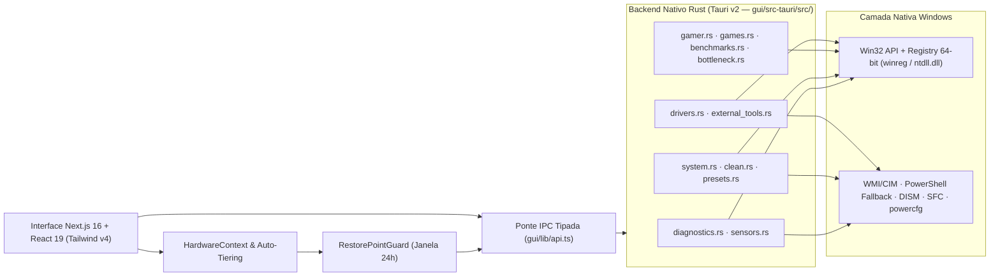

<div align="center">


# System Optimizer Tool `v6.0`

**Suíte nativa de engenharia de sistemas, diagnóstico profundo de hardware, baixa latência competitiva e manutenção automatizada para Windows.**

[](https://github.com/jefheee/System-Optimizer-Tool/releases)
[-0284c7?style=for-the-badge&logo=windows)](https://microsoft.com/windows)
[](https://tauri.app)
[](gui/src-tauri/src/lib.rs)
[](gui/lib/i18n.ts)
[](LICENSE)

<br />

[Visão Geral](#-visão-geral--evolução-arquitetural) •
[Arquitetura](#️-arquitetura-do-sistema) •
[As 6 Abas Técnicas](#-ecossistema-completo--as-6-abas-técnicas) •
[Segurança & Guardrails](#️-engenharia-de-segurança--guardrails-críticos) •
[Estrutura](#-estrutura-do-repositório) •
[Build & Testes](#-desenvolvimento-auto-testes--build-de-produção)

</div>

---

## ⚡ Visão Geral & Evolução Arquitetural

O **System Optimizer Tool** nasceu como uma rotina modular em Batch/PowerShell para manutenção técnica pós-formatação (`cli/`) e evoluiu na **versão 6.0** para uma aplicação desktop nativa de alta precisão compilada em **Rust (`Tauri v2`)** com interface reativa em **Next.js 16 (App Router), React 19, TypeScript Strict e Tailwind CSS v4**.

Diferente de "tweakers" genéricos baseados em scripts opacos, cada operação do projeto foi projetada com **transparência técnica integral** e rigor determinístico:

- **Acesso Direto ao Kernel & Win32 API:** Manipulação nativa via `windows` v0.61 (`Win32_System_Threading`, `Win32_System_ProcessStatus`, `Win32_System_Services`, `Win32_Storage_FileSystem`), `winreg` (visão pura de Registro 64-bit), `ntdll.dll` (`NtSetTimerResolution`), WMI/CIM, `DISM`/`SFC` e `powercfg` — sem janelas de prompt piscando em segundo plano.
- **Padrão Auditável `Check / Apply / Revert`:** Tweaks lêem o estado real do sistema operacional antes de agir e oferecem reversão direta com chaves, comandos e impacto documentados.
- **Proteção Preventiva Obrigatória (`RestorePointGuard`):** Ajustes de risco médio/alto, presets e debloat exigem verificação automática de Ponto de Restauração recente (últimas 24h) antes de modificar o sistema.
- **Compatibilidade Universal & Auto-Tiering:** Classificação automática do Windows (`Win7` até `Win11 26H2`) e adaptação visual automática de animações/blur conforme a potência e o estado de bateria da máquina (`low` / `mid` / `high`).
- **Bilíngue Nativamente (`PT-BR` & `EN-US`):** Interface, diagnósticos e enciclopédia técnica alternáveis em tempo real (preservando as **6 abas técnicas padronizadas `SYS`** em inglês como identidade de navegação).

---

## 🏗️ Arquitetura do Sistema



---

## 🧭 Ecossistema Completo — As 6 Abas Técnicas

A interface consolida **todo o ciclo de vida de diagnóstico, otimização, gaming, periféricos, drivers e documentação** em **6 módulos principais** com navegação lateral contextual (`LeftSidebar`) e monitor de sensores **`AO VIVO / LIVE`** fixo no rodapé.

| Aba Superior | Sub-Módulos na Sidebar | Foco Técnico Principal |
| :--- | :--- | :--- |
| **`01. SYS CORE`** | `core-overview` · `core-system` · `core-sensors` · `core-benchmarks` | Telemetria de hardware, auditoria de BIOS/PCIe/NVMe, estresse e benchmarks |
| **`02. SYS OPTIMIZE`** | `opt-presets` · `opt-system` · `opt-debloat` · `opt-clean` · `opt-network` · `opt-startup` | Presets 1-clique, setup pós-formatação, remoção de IA, limpeza, rede e áudio |
| **`03. SYS GAMING`** | `gaming-library` · `gaming-gpu` · `gaming-latency` · `gaming-overlay` | Game Booster, GPU Flip Models/P0/ULPS, afinidade de CPU, HUD e fix de 1% Lows |
| **`04. SYS TUNING`** | `tuning-power` · `tuning-peripherals` · `tuning-sync` · `tuning-whea` | Energia/XMP, mouse linear 1:1, overclock `hidusbf`, USB/RGB, WHEA e Anti-Cheats |
| **`05. SYS DRIVERS`** | `drv-auditor` · `drv-winget` · `drv-hub` · `drv-maker` | Inventário WHQL/DISM, Winget + Pós-Processamento, USB `autounattend.xml` e Maker INF |
| **`06. SYS DOCS`** | `docs-encyclopedia` · `docs-bios` · `docs-about` | Enciclopédia bilíngue de registro/CLI, guia de BIOS e integridade do código |

---

<details open>
<summary><h3>01. <code>SYS CORE</code> — Diagnóstico Profundo, BIOS, Sensores & Benchmarks</h3></summary>

- **Visão Geral & Checkup (`core-overview`):**
  - Score global de otimização, classificação automática de **Hardware Tier** (`low` / `mid` / `high`) e detecção de chassi (`Desktop` vs `Laptop` / bateria).
  - Painel de auditoria ao vivo (`Check / Apply / Revert`) com mais de 15 verificações em tempo real no Registro e acesso rápido à criação de Ponto de Restauração e presets recomendados.
- **Auditoria Completa de Sistema & BIOS (`core-system`):**
  - **BIOS & Firmware Readiness:** Leitura real de modo **UEFI / Legacy**, versão e data da BIOS (com link de suporte da placa-mãe), **Resizable BAR**, perfil **XMP / DOCP / EXPO**, **Secure Boot**, **TPM 2.0** e status de **VBS / Core Isolation**.
  - **GPU & Barramento PCIe:** Verificação das propriedades PnP (`DEVPKEY_PciDevice_CurrentLinkSpeed` e `CurrentLinkWidth` vs. `MaxLinkWidth`, detectando gargalos de *lane sharing*), suporte a **MSI Mode**, assinatura **WHQL** e alerta se o monitor estiver conectado à **iGPU** em vez da placa dedicada.
  - **Armazenamento & Memória:** Saúde de SSD/NVMe/HDD, verificação de **TRIM**, alertas preventivos para volumes com espaço livre crítico (`< 15%`) e topologia completa de slots, canal (`Dual Channel`) e frequência real da RAM.
  - **Exportação Externa:** Geração de relatório completo do PC em **`JSON`**, **`TXT`** e **`Markdown`** fora dos cartões individuais.
- **Sensores & Estresse (`core-sensors`):**
  - Polling contínuo de temperatura e carga de CPU, GPU e RAM com controle integrado de **Stress Test** (CPU, RAM e Disco) para validação térmica e de estabilidade.
- **Benchmarks & Gargalo (`core-benchmarks`):**
  - Benchmarks nativos de **Disco** (leitura/escrita sequencial + 4K Random IOPS + latência em µs), **RAM** (largura de banda Read/Write/Copy em GB/s e latência em ns), **Simulador de CPU & FPS** (`1080p`/`1440p`/`4K`) e **Calculadora de Gargalo CPU vs. GPU**.

</details>

<details>
<summary><h3>02. <code>SYS OPTIMIZE</code> — Setup Inicial, Debloat Cirúrgico, Limpeza, Rede & Áudio</h3></summary>

- **Presets 1-Clique (`opt-presets`):**
  - 4 perfis orquestrados com barra de progresso em tempo real (`LiveProgressDrawer`): **`Manutenção Essencial`** (`essential`), **`Modo Gamer & FPS`** (`gamer`), **`Notebook & Eficiência`** (`notebook`) e **`Privacidade Extrema & Debloat`** (`privacy`).
- **Setup & Sistema (`opt-system`):**
  - **Auditoria & Desencriptação BitLocker:** Leitura via `manage-bde -status` em `C:` e volumes fixos, com gatilho seguro para desencriptar unidades quando o usuário busca latência I/O mínima em NVMe.
  - **Compressão Inteligente de RAM (`MMAgent`):** Calibração automática baseada no total de RAM instalada.
  - **Sincronização Atômica NTP (`w32tm`):** Correção imediata de relógio para evitar falhas de SSL/TLS e sessões Anti-Cheat.
  - **Windows Update (Pausa de 1 Ano + Limpeza):** Adiamento controlado de atualizações de recursos/qualidade + limpeza do cache `SoftwareDistribution\Download`.
  - **Shell & Produtividade Limpa:** Menu de contexto clássico do Windows 11, **Bloco de Notas Limpo** (desativando botões de IA/Copilot e restauração de abas sem removê-lo), tema **Full Blackout** (transparência desativada) e visibilidade de extensões de arquivo.
- **Debloat, Remoção de IA & Reparo (`opt-debloat`):**
  - **Extermínio de IA do Windows 11 (24H2–26H2):** Desativação por GPO/Registro de **Windows Copilot**, **Windows Recall** (`DisableAIDataAnalysis`), **Paint Cocreator**, Bing Web Search e serviços de telemetria (`DiagTrack`, `dmwappushservice`).
  - **Debloat Blindado + Restauração:** Remoção seletiva de bloatwares AppX protegida por **Whitelist rígida** que impede a remoção acidental de dependências vitais, além de restauração em 1 clique da pilha Xbox, Microsoft Store e Calculadora.
  - **Integridade do Sistema:** Execução integrada de **`SFC /scannow`** e **`DISM /RestoreHealth`**.
- **Limpeza Profunda & Disco (`opt-clean`):**
  - Limpeza granular de caches de shader (**DirectX**, **NVIDIA `DXCache`/`GLCache`**, **AMD `DxCache`**), diretórios temporários, `C:\Windows\Prefetch`, logs de eventos, `Windows.old`, limpeza de WinSxS via `DISM`, Lixeira e controle do `hiberfil.sys` (hibernação).
- **Rede Competitiva & Áudio (`opt-network`):**
  - **Pilha TCP/IP & DNS:** `TcpAckFrequency = 1` + `TCPNoDelay = 1` (Nagle Off), benchmark de DNS em tempo real (Cloudflare, Google, Quad9, etc.) e aplicação instantânea no adaptador ativo.
  - **Hardware de Rede & IPv4-Only:** Desativação de economia de energia da placa de rede (**EEE / Green Ethernet / Wake on Magic Packet**) e alternância para modo **IPv4-Only** (desvinculando `ms_tcpip6` do adaptador ativo com reversão imediata).
  - **Injetor de Loudness Equalization (Áudio Competitivo):** Injeção direta nas `FxProperties` do endpoint ativo em `MMDevices\Audio\Render` para realçar passos/efeitos sutis em FPS competitivos com reinício suave do serviço `Audiosrv`.
- **Inicialização & Serviços (`opt-startup`):**
  - Auditoria e gerenciamento de entradas de inicialização automática, remoção de tarefas agendadas órfãs e controle de serviços em segundo plano.

</details>

<details>
<summary><h3>03. <code>SYS GAMING</code> — GPU Engineering, P0 State, Afinidade de CPU & 1% Lows Fix</h3></summary>

- **Biblioteca & Game Booster (`gaming-library`):**
  - Scanner automático de bibliotecas instaladas (Steam, Epic Games, Riot, Battle.net, EA, Ubisoft, Xbox) com rotina rápida de priorização pré-jogo.
- **Subsistema Gráfico, Flip Models & Perfis 3D (`gaming-gpu`):**
  - **HAGS & OFWG:** Controle de *Hardware-Accelerated GPU Scheduling* (`HwSchMode`) e *Optimizations for Windowed Games* (*Independent Flip* em DX10/DX11 sem tela preta ao usar `Alt+Tab` em monitores com DSC).
  - **Estado P0 / GPU Boost Máximo (`DisableDynamicPstate = 1`):** Evita quedas para *Boost 1* em jogos CPU-bound (como CS2 e VALORANT), equipado com **Guardrail de Notebook/Bateria** exibindo aviso de consumo em idle.
  - **HDCP Off, MPO Off & FSO Legacy:** Alternância de `RMHdcpKeyglobZero = 1`, `OverlayTestMode = 5` (Multi-Plane Overlay) e `GameConfigStore` (`GameDVR` / FSO).
  - **AMD ULPS com Trava de Segurança RX 7000+:** Desativação segura do *Ultra Low Power State*, bloqueando automaticamente o ajuste quando uma GPU **Radeon RX 7000+** opera com **HAGS ativo** para evitar instabilidades críticas de driver.
  - **Otimizador de Serviços de GPU & Perfis 3D:** Detecção e controle do **`Intel(R) PresentMon Service`** (conhecido por consumir 1%–2% contínuos de CPU em idle), `AMD Crash Defender Service`, `AMD External Events Utility` e `NvTelemetryContainer`, além de aplicador de perfil 3D adaptado ao fabricante (NVIDIA / AMD).
- **CPU, Latência 0.5ms, MMCSS & Afinidade (`gaming-latency`):**
  - **Timer Resolution 0.5ms & Memory Flush:** Chamada nativa via `ntdll.dll` (`NtSetTimerResolution`) e limpeza controlada de Working Set em processos ativos.
  - **Escalonamento & MMCSS:** Seletor de **`Win32PrioritySeparation`** (`0x26` Short Variable 2:1, `0x38` Long Fixed, `0x02` Padrão) e tuning de **`MMCSS SystemProfile`** (`SystemResponsiveness = 10`, `NetworkThrottlingIndex = 0xFFFFFFFF`, `Tasks\Games` Priority 6).
  - **Calculadora & Afinidade por Processo:** Preview em tempo real da máscara hexadecimal para **`SMT/HT Off`** (apenas cores físicos, ex: `0x5555` em 8C/16T) e **`Core 0 Off`** (`0xFFFC`), aplicação em processos ativos (`>= 200 MB`) e **Herança de Afinidade Anti-Cheat-Safe** relançando clientes **Steam** e **Epic Games** com `start "" /affinity <hex>` para propagar a máscara aos jogos filhos sem violar proteção kernel de anti-cheats.
- **HUD Overlay Nativo & Fix Crítico de 1% Lows (`gaming-overlay`):**
  - **HUD Overlay Flutuante (`?overlay=1`):** Janela frameless dedicada exibindo FPS/frametime estimado, carga e temperatura de CPU/GPU e uso de RAM em tempo real.
  - **Patcher MSI Afterburner + RTSS (`MSIAfterburner.cfg`):** Cria backup automático (`MSIAfterburner.cfg.bak`) e desativa o polling dos sensores **`GPU power`** e **`Power percent`** — causa documentada de quedas bruscas de *1% Lows* e micro-stuttering em jogos competitivos — mantendo os demais sensores intactos e configurando hotkeys **`F10`** (Toggle OSD), **`F11`** (Begin Benchmark) e **`F12`** (End Benchmark).

</details>

<details>
<summary><h3>04. <code>SYS TUNING</code> — Energia, Mouse Linear 1:1, <code>hidusbf</code>, USB & Matriz Anti-Cheat</h3></summary>

- **Planos de Energia & Overclock Scan (`tuning-power`):**
  - Alternância direta entre **Equilibrado**, **Alto Desempenho** e **Desempenho Máximo (Ultimate Performance)** acompanhada de leitura real de clock atual/multiplicador de CPU e perfil **XMP / DOCP / EXPO** da RAM.
- **Mouse, Controle & Monitor (`tuning-peripherals`):**
  - **Curva Linear 1:1 Sem Aceleração (Estilo MarkC):** Geração matemática exata dos vetores binários `SmoothMouseXCurve` e `SmoothMouseYCurve` no registro (`HKCU\Control Panel\Mouse`) para escalas de DPI **`100%`, `125%`, `150%`, `175%`, `200%` e `225%`**, mantendo **`MouseSpeed = "1"`** com inclinação estritamente linear (zero aceleração positiva ou negativa) e guardrail de segurança para notebooks com trackpad.
  - **Polling Rate em Segundo Plano (1000Hz–8000Hz):** Desbloqueio via registro (`ForegroundLockTimeout = 0` e ajustes de fila RAW Input) para impedir quedas de taxa de atualização em jogos e apps.
  - **Overclock de Controle WHQL (`hidusbf`):** Central dedicada para elevação de controles USB a 1000Hz / 1ms via release oficial [`hidusbf`](https://github.com/LordOfMice/hidusbf/releases), atalho direto para `mmsys.cpl` e checklist de porta USB fixa em 4 passos.
  - **Laboratórios de Validação Externa:** Acesso rápido ao teste de frame-skipping/ghosting [**BlurBusters UFO**](https://www.testufo.com/) e medição de [**Waveform Bufferbloat SQM**](https://www.waveform.com/tools/bufferbloat).
- **USB & RGB Sync (`tuning-sync`):**
  - **Scanner USB em 3 Camadas (Zero Admin para leitura):** Mapeamento de controladores host e dispositivos conectados com inspeção de saúde e detecção de conflitos entre utilitários de RGB.
  - **Desativador Global de Economia de Energia USB/HID:** Varredura recursiva em `HKLM\SYSTEM\CurrentControlSet\Enum\USB` e `HID` (`Device Parameters`: `EnhancedPowerManagementEnabled = 0`, `AllowIdleIrpInD3 = 0`, `DeviceSelectiveSuspended = 0`, `SelectiveSuspendEnabled = 0`) combinada com desativação de Suspensão Seletiva USB AC/DC no `powercfg` (totalmente reversível).
- **Auditoria WHEA & Matriz de Prontidão Anti-Cheat (`tuning-whea`):**
  - **Leitor de Estabilidade Hardware (Event Log):** Monitoramento de **`WHEA-Logger` (Event IDs 18, 19, 46, 47)**, **`Kernel-Power 41`** e **`Display 4101` (TDR GPU Resets)** para identificar instabilidades de overclocks, RAM XMP ou barramento PCIe.
  - **Matriz Competitiva Anti-Cheat:** Auditoria em tempo real de **TPM 2.0**, **Secure Boot**, **Control Flow Guard (CFG)**, **Isolamento de Núcleo / VBS** e **DEP**, com diagnóstico e correção rápida para:
    - **VALORANT (`Riot Vanguard`)** — Ativação/reversão de CFG;
    - **CS2 (`FACEIT Anti-Cheat`)** — Alerta e toggle de VBS / HVCI;
    - **Fortnite / Warzone / Tarkov (`EAC / BattlEye / Ricochet`)** — Verificação de DEP e integridade de boot.

</details>

<details>
<summary><h3>05. <code>SYS DRIVERS</code> — Drivers WHQL, Apps Pós-Formatação, USB Bootável & Maker Serial</h3></summary>

- **Auditor de Drivers & Backup DISM (`drv-auditor`):**
  - Inventário via WMI (`Win32_PnPSignedDriver`) filtrado por GPU, Rede, Áudio, Armazenamento, Chipset e USB/Serial com status de assinatura WHQL, códigos de erro PnP e **Exportação de Backup DISM** para restauração rápida pós-formatação.
- **Smart App Installer & Motor de Pós-Processamento (`drv-winget`):**
  - Instalação em lote via **Winget** de utilitários essenciais e runtimes organizados por categoria.
  - **Ferramentas Portáteis de Precisão:** Links e curadoria para `Logitech Onboard Memory Manager (OMM)`, `MoreClockTool (MCT)`, `Custom Resolution Utility (CRU)` e `NVIDIA Profile Inspector`.
  - **Pós-Processamento Inteligente de Apps (`run_app_post_processing`):**
    - Nivelamento automático de atalhos no Menu Iniciar (remoção de subpastas redundantes).
    - Políticas de GPO para **Chrome**, **Brave** e **Edge** (`BackgroundModeEnabled = 0`, `HighEfficiencyModeEnabled = 1`, opção de `HardwareAccelerationModeEnabled = 0` e desativação de serviços/tarefas `gupdate`/`brave`).
    - Debloat automático de **Discord & Spotify** (remoção do auto-boot no Registro e edição segura de `%APPDATA%\discord\settings.json`: `MINIMIZE_TO_TRAY = false`, `OPEN_ON_STARTUP = false`, `enableHardwareAcceleration = false`).
- **Formatação Limpa, Gerador USB (`autounattend.xml` + `$OEM$`) & Hub (`drv-hub`):**
  - **Gerador Nativo de Mídia Desassistida:** Exporta diretamente para pendrive ou pasta o arquivo **`autounattend.xml`** (com bypass opcional de `TPM`, `SecureBoot`, `RAM` e `CPU` do Windows 11, supressão de telemetria no OOBE e criação automática de **Conta Local**) + injeção da árvore **`$OEM$\$$\Setup\Scripts\SetupComplete.cmd`** bloqueando instalação automática de drivers via Windows Update (`ExcludeWUDriversInQualityUpdate = 1`) e bloatwares OEM antes do primeiro boot.
  - **Assistente Conta Microsoft → Conta Local (Sem Formatar):** Checklist guiado integrado ao `netplwiz` / `lusrmgr.msc`.
  - **Regra de Ouro Dinâmica de Drivers de Placa-Mãe:** Detecta automaticamente a CPU instalada — orienta manter áudio nativo e instalar apenas Rede/Bluetooth, alertando exceção obrigatória de driver de Chipset apenas em processadores **AMD Ryzen Dual-CCD X3D** (`7900X3D`, `7950X3D`, `9950X3D`) para o correto funcionamento do *3D V-Cache Core Parking*.
  - **Hub de Ferramentas da Comunidade (`ExternalToolsModule`):** Acesso integrado e guiado ao **Chris Titus Tech WinUtil**, **Microsoft Activation Scripts (MAS)**, **O&O ShutUp10++**, **AdwCleaner**, **Winget Upgrade**, **CPU-Z**, **GPU-Z** e **HWMonitor**.
- **Drivers Maker Serial Embarcados (`drv-maker`):**
  - Instalação offline via `PnPUtil` na DriverStore de pacotes `.inf` seriais USB-UART (`CH340`, `CP210x`, `FTDI`, `Arduino` para placas ESP32, ESP8266 e Arduino) presentes em `gui/src-tauri/drivers/`, além de limpeza do cache `Arduino15`.

</details>

<details>
<summary><h3>06. <code>SYS DOCS</code> — Enciclopédia Técnica, Guia de BIOS & Integridade</h3></summary>

- **Enciclopédia Técnica Bilíngue (`docs-encyclopedia`):**
  - Documentação pesquisável cobrindo desde fundamentos de latência até todos os verbetes avançados (ex: `afterburner_1percent_low`, `gpu_p0_state`, `ofwg_hags`, `mpo_ulps_guard`, `cpu_affinity_smt_core0`, `mmcss_win32prio`, `mouse_dpi_linear`, `hidusbf_overclock`, `anticheat_matrix`, `autounattend_usb`, `bitlocker_off`, `loudness_eq_inject`, `ipv4_only_mode`, `usb_nic_power_off`), detalhando exatamente *o que muda*, *chaves afetadas*, *nível de risco* e *como reverter*.
- **Guia de BIOS & Soluções (`docs-bios`):** Checklist prático para ativação segura de XMP/EXPO, Resizable BAR, virtualização e ajustes de C-States sem provocar erros WHEA.
- **Sobre & Integridade (`docs-about`):** Visão transparente da arquitetura Rust + Tauri v2, diretrizes de código aberto e filosofia zero-ofuscação.

</details>

---

## 🛡️ Engenharia de Segurança & Guardrails Críticos

1. **Motor Preventivo `RestorePointGuard`:**
   Toda alteração de risco médio/alto, debloat ou preset passa por `requireRestorePoint` em [`HardwareContext.tsx`](gui/lib/HardwareContext.tsx). O sistema audita pontos criados nas últimas 24 horas (`get_restore_points_status`), desbloqueia a trava nativa de frequência do Windows (`SystemRestorePointCreationFrequency = 0`) e solicita criação automática via [`RestorePointModal.tsx`](gui/components/RestorePointModal.tsx) antes de executar a rotina.
2. **Whitelist Blindada de Pacotes Windows:**
   Em [`system.rs`](gui/src-tauri/src/system.rs), a função `is_protected_package` protege pacotes críticos contra remoção acidental no debloat — incluindo **`Microsoft.EdgeWebView2`** / **`WebView2Runtime`** (dependência vital do runtime Tauri v2), **`VBScript`** (instaladores legados/MSI), `Paint`, `Photos`, `Notepad`, extensões de mídia (`HEVC`, `AV1`, `WebP`), `NetFx3` e `WindowsStore`.
3. **Travas Específicas de Hardware & Portáteis:**
   - **Radeon RX 7000+ & HAGS (`check_ulps_safety_guard`):** Impede desativação conflitante de ULPS quando uma GPU série RX 7000/9000 está com HAGS habilitado.
   - **Notebooks / Bateria:** Avisos contextuais automáticos antes de travar **Estado P0** na GPU ou alterar **curvas lineares de mouse** (protegendo a sensação de trackpads).
4. **Auto-Tiering & Performance Adaptativa:**
   `computeHardwareTierFromDiagnostics` identifica máquinas `low`, `mid` ou `high` e desativa efeitos visuais pesados em hardware modesto ou operando em bateria (a menos que o usuário force o modo manual em Configurações).

---

## 📁 Estrutura do Repositório

```text
System-Optimizer-Tool/
├── gui/                              # Aplicação Desktop principal (Next.js 16 + Tauri v2)
│   ├── app/                          # App Router: layout.tsx, globals.css e shell principal (page.tsx + ?overlay=1)
│   ├── components/                   # 23 módulos UI React + componentes base ui/
│   │   ├── TopNavbar.tsx             # Barra superior frameless com as 6 abas fixas SYS
│   │   ├── LeftSidebar.tsx           # Menu lateral contextual + monitor AO VIVO fixo
│   │   ├── RestorePointModal.tsx     # Gate interativo do RestorePointGuard
│   │   ├── SysCoreSystemView.tsx     # Auditoria BIOS/RAM/Disco/PCIe + GPU Flip Models & Perfis 3D
│   │   ├── SensorsAndStressModule.tsx# Telemetria ao vivo, Stress Test & Fix Afterburner 1% Lows
│   │   ├── GamerModule.tsx           # Timer 0.5ms, Win32PrioritySeparation, MMCSS & Afinidade CPU
│   │   ├── TuningModule.tsx          # Energia/XMP, Mouse 1:1 DPI, hidusbf, WHEA & Matriz Anti-Cheat
│   │   ├── DriversAndAppsModule.tsx  # Auditor WHQL, Winget + Post-Processing, Boot USB & Serial Maker
│   │   └── ...                       # CleanModule, SystemModule, PresetsModule, SyncAndUsbModule, etc.
│   ├── lib/                          # api.ts (IPC tipado + previews), HardwareContext.tsx, SettingsContext.tsx, i18n.ts
│   └── src-tauri/                    # Core Desktop nativo em Rust (Tauri v2)
│       ├── Cargo.toml                # Dependências: tauri 2.11, windows 0.61, winreg 0.55, wmi 0.14, sysinfo 0.33
│       ├── tauri.conf.json           # Bundle config (v6.0.0, NSIS/MSI, recursos drivers/**)
│       ├── drivers/                  # Pacotes INF offline embarcados (CH340, CP210x, FTDI, Arduino)
│       └── src/
│           ├── lib.rs                # Registro de comandos Tauri & suíte de 11 testes unitários (cargo test)
│           ├── diagnostics.rs        # Classificação Universal de SO (Win7–Win11 26H2), Hardware Tiering & BIOS
│           ├── system.rs             # Tweaks ao vivo (Check/Apply/Revert), BitLocker, IA/Debloat Guard, Áudio & Rede
│           ├── clean.rs              # Shader caches, Prefetch, DISM WinSxS, Windows.old & Hibernação
│           ├── gamer.rs              # HAGS/OFWG/P0/ULPS, Win32Priority, MMCSS, Afinidade, Mouse 1:1, Afterburner, Anti-Cheat
│           ├── drivers.rs            # PnPSignedDriver, USB Scan 3 camadas, USB Power Off, autounattend.xml & App Post-Processing
│           └── ...                   # presets.rs, sensors.rs, benchmarks.rs, bottleneck.rs, games.rs, external_tools.rs, state.rs, utils.rs
├── cli/                              # Compatibilidade histórica em terminal (Optimizer.ps1 / SystemOptimizer.bat)
├── docs/                             # Documentação Docs-as-Code (PROJECT_STATE.md, CHANGELOG.md; internal/ é ignorado no Git)
├── public/assets/branding/           # Logos oficiais e identidade visual
├── .github/workflows/release.yml     # Pipeline automatizado de release
└── LICENSE                           # Licença MIT
```

---

## 🚀 Desenvolvimento, Auto-Testes & Build de Produção

### Pré-requisitos

1. **[Node.js](https://nodejs.org/)** `v18` ou superior (`npm` incluso)
2. **[Rust & Cargo](https://www.rust-lang.org/tools/install)** versão estável (`rust-version >= 1.77.2`)
3. **[Visual Studio C++ Build Tools](https://visualstudio.microsoft.com/visual-cpp-build-tools/)** (carga de trabalho *Desenvolvimento para desktop com C++* + Windows SDK)
4. **[Microsoft Edge WebView2 Runtime](https://developer.microsoft.com/microsoft-edge/webview2/)** (pré-instalado no Windows 10/11)

### 1. Clonar e Executar em Modo Desenvolvimento

```powershell
git clone https://github.com/jefheee/System-Optimizer-Tool.git
cd System-Optimizer-Tool/gui
npm install
npm run tauri dev
```

> 💡 **Dica de Engenharia:** Para testar os comandos que escrevem em `HKLM`, gerenciam serviços ou usam `powercfg`/`manage-bde`, execute o terminal como **Administrador** ou utilize o botão de elevação na barra superior do aplicativo.

### 2. Suíte de Auto-Testes & Validação de Qualidade

Todas as fórmulas matemáticas (curvas lineares de DPI, bitmasks de afinidade CPU, trava RX 7000+ ULPS/HAGS), geradores (`autounattend.xml` + `SetupComplete.cmd`), patchers de `.cfg`, auditoria sem pânico no Registro e whitelists de segurança possuem cobertura determinística em Rust:

```powershell
# Backend Rust — Compilação e 11 Testes Unitários (gui/src-tauri)
cd gui/src-tauri
cargo check --all-targets
cargo test --no-fail-fast -- --nocapture

# Frontend Next.js / TypeScript — Tipagem estrita, Lint e Build Estático (gui)
cd ..
npx tsc --noEmit
npm run lint
npm run build
```

<details>
<summary>📋 Lista dos 11 Testes Unitários Nativos em <code>gui/src-tauri/src/lib.rs</code></summary>

1. `test_classify_os_tier_universal` — Classificação correta de Windows 7 até Windows 11 26H2.
2. `test_classify_hardware_tier` — Auto-detecção de Hardware Tier (`low` / `mid` / `high`).
3. `test_cpu_affinity_bitmask_calculations` — Bitmasks `smt_off`, `core0_off` e `all_cores` para CPUs 4C/8T até 16C/32T + non-SMT.
4. `test_afterburner_cfg_1percent_low_patcher` — Desativação de polling de energia e atalhos `F10`/`F11`/`F12` no `MSIAfterburner.cfg`.
5. `test_autounattend_xml_and_setup_complete_generation` — Bypass de TPM/SecureBoot/RAM/CPU, sanitização de usuário local e bloqueio OEM/WU.
6. `test_protected_packages_guard` — Proteção crítica de `EdgeWebView2`, `VBScript` e `WindowsStore`.
7. `test_linear_mouse_curve_scales_without_acceleration` — Prova matemática de inclinação linear constante para curvas DPI `100%`–`225%`.
8. `test_expanded_protected_packages_whitelist` — Proteção de `Paint`, `Photos`, `Notepad`, `HEVC`/`AV1`/`WebP`, `NetFx3` e remoção segura de bloatware.
9. `test_ulps_rx7000_hags_safety_guard` — Bloqueio obrigatório de ULPS em RX 7000+ com HAGS ativo e permissão segura fora do cenário de risco.
10. `test_read_live_tweaks_sync_no_panic` — Auditoria síncrona do Registro real do Windows sem pânicos.
11. `test_usb_scanner_returns_devices` — Descoberta PnP em múltiplos barramentos USB/HID/BT/COM sem exigir elevação para leitura.

</details>

### 3. Gerar Instalador de Produção (`.exe` / `.msi`)

```powershell
cd gui
npm run tauri build
```

Os executáveis otimizados e instaladores **NSIS / MSI** (sem console de debug) são gerados em:

```text
gui/src-tauri/target/release/bundle/
```

---

## 💻 Modo CLI Legado

Para ambientes mínimos de recuperação ou execução rápida sem interface gráfica, o repositório mantém os scripts históricos em `cli/`:
- [`cli/SystemOptimizer.bat`](cli/SystemOptimizer.bat)
- [`cli/Optimizer.ps1`](cli/Optimizer.ps1)

---

## 📄 Licença

Distribuído sob a licença **MIT**. Consulte o arquivo [`LICENSE`](LICENSE) para mais detalhes.

<div align="center">
<sub>Construído com precisão de sistema em Rust, Tauri v2 e Next.js 16 • Transparência, Reversibilidade e Segurança em Primeiro Lugar</sub>
</div>
